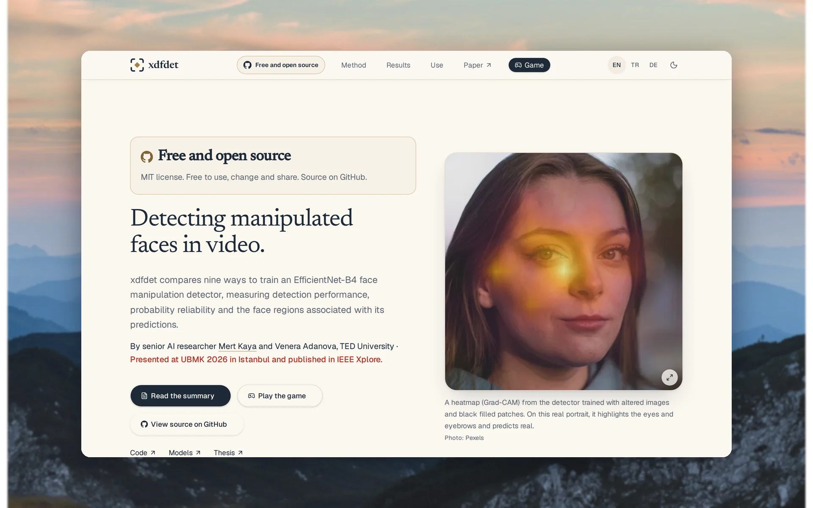
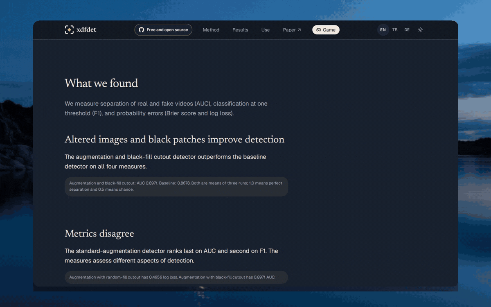
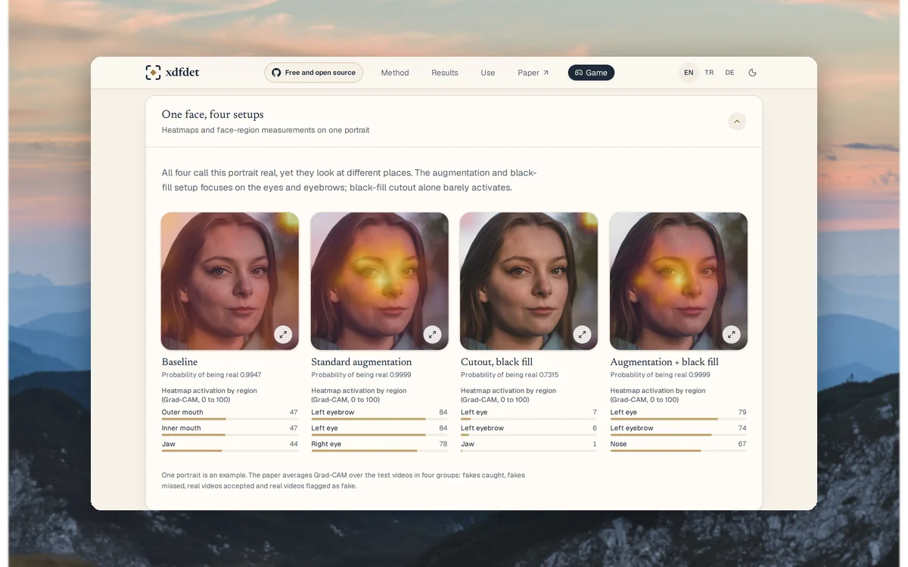
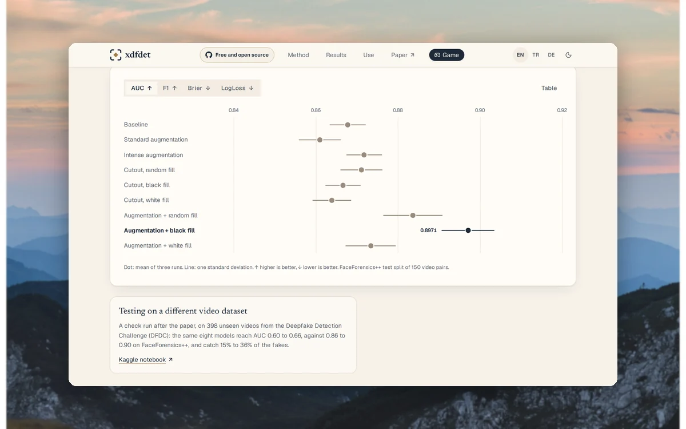
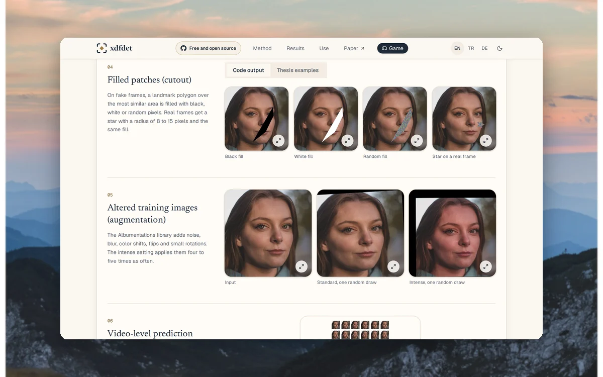
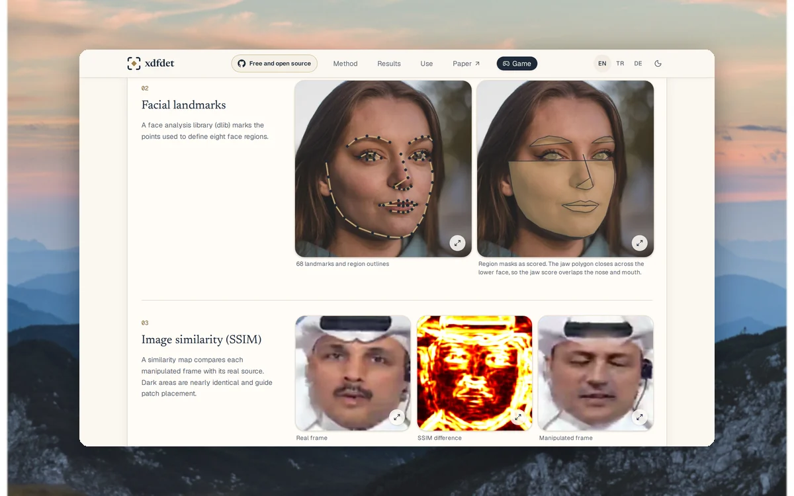

<p align="center">
  <picture>
    <source media="(prefers-color-scheme: dark)" srcset="docs/brand/svg/xdfdet-logo-on-dark.svg">
    
  </picture>
</p>

<h1 align="center">Detect manipulated faces. Check every verdict.</h1>

<p align="center">
  Open-source deepfake video detection with Grad-CAM explanations.<br>
  <b>Eight EfficientNet-B4 models. Published at IEEE UBMK 2026.</b>
</p>

<p align="center">
  <a href="pyproject.toml"></a>
  <a href="LICENSE"></a>
  
  <a href="https://huggingface.co/mertkayacs/xdfdet"></a>
  <a href="https://doi.org/10.1109/UBMK71847.2026.11745298"></a>
  <a href="https://github.com/mertkayacs/xdfdet"></a>
</p>

<p align="center">
  <a href="#quick-start"></a>
  <a href="https://xdfdet.mertkayacs.com/?utm_source=github&utm_medium=readme&utm_campaign=xdfdet-repo&utm_content=website-badge"></a>
  <a href="https://ieeexplore.ieee.org/document/11745298"></a>
  <a href="https://huggingface.co/mertkayacs/xdfdet"></a>
  <a href="https://www.kaggle.com/models/mertilovski/xdfdet"></a>
  <a href="https://doi.org/10.5281/zenodo.18998566"></a>
</p>

<p align="center">
  <picture>
    <source media="(prefers-color-scheme: dark)" srcset="docs/assets/readme/hero-dark.webp">
    
  </picture>
</p>

xdfdet is an open-source toolkit for explainable deepfake video detection. It scores a face video as real or manipulated with one of eight EfficientNet-B4 models trained on FaceForensics++, and saves a Grad-CAM heatmap with the activation measured in eight facial regions. The code accompanies Mert Kaya's MSc thesis at TED University and the IEEE UBMK 2026 paper he wrote with Venera Adanova, which compare nine training setups of data augmentation and cutout on accuracy, calibration and attention. A command line covers prediction, face cropping, training, evaluation and region analysis, and the weights download from Hugging Face on first use.

---

## Why xdfdet

In high-stakes settings, a detector's verdict helps only when someone can check it.

|  |  |
|---|---|
|  **Evidence for each verdict** | `xdfdet predict --gradcam` saves a Grad-CAM heatmap and scores the activation from 0 to 100 in eight facial regions built from 68 landmarks. `xdfdet analyze` splits those scores by correct and wrong predictions ([explain.py](src/xdfdet/explain.py)). |
|  **A controlled comparison** | In the paper, the nine setups share data, model, optimizer, training schedule and dropout 0.55, and vary augmentation and cutout. The notebook of the released `aug-cutout-random` checkpoint used dropout 0.25 ([config.py](src/xdfdet/config.py)). Augmentation with black-fill cutout reached 0.8971 AUC against 0.8678 for the baseline, means over three runs. |
|  **Calibration next to accuracy** | Every setup is scored on AUC, F1, Brier score and log loss, and the four measures favor different setups: augmentation with random-fill cutout has the lowest log loss (0.4656), augmentation with black-fill cutout the highest AUC. |
|  **Eight released models** | One `.keras` file per released setup on [Hugging Face](https://huggingface.co/mertkayacs/xdfdet) and [Kaggle](https://www.kaggle.com/models/mertilovski/xdfdet), under CC BY-NC 4.0. `xdfdet.load_model(name)` downloads one on first use and reads only its weights. |
|  **Limits on record** | On 398 unseen DFDC videos the same models reach AUC 0.60 to 0.66 and catch 15% to 36% of the fakes ([Kaggle notebook](https://www.kaggle.com/code/mertilovski/xdfdet-on-dfdc)). Performance across age, sex and skin tone was not measured. |
|  **Traceable to the paper** | Settings come from the original Colab notebooks, and the [notes on the original runs](#notes-on-the-original-runs) list where the notebooks differ from the paper. The paper is in [IEEE Xplore](https://ieeexplore.ieee.org/document/11745298), pages 78 to 83. |

## A quick tour

<p align="center">
  
</p>

<table>
  <tr>
    <td width="50%" valign="top">
      <picture>
        <source media="(prefers-color-scheme: dark)" srcset="docs/assets/readme/attention-dark.webp">
        
      </picture>
      <h3>One face, four setups</h3>
      All four detectors call this portrait real, and each one looks somewhere else. Augmentation with black-fill cutout focuses on the eyes and eyebrows.
    </td>
    <td width="50%" valign="top">
      <picture>
        <source media="(prefers-color-scheme: dark)" srcset="docs/assets/readme/results-dark.webp">
        
      </picture>
      <h3>Nine setups, four metrics</h3>
      Means and standard deviations over three runs for every setup, on AUC, F1, Brier score and log loss. The ranking changes with the metric.
    </td>
  </tr>
  <tr>
    <td width="50%" valign="top">
      <picture>
        <source media="(prefers-color-scheme: dark)" srcset="docs/assets/readme/cutout-dark.webp">
        
      </picture>
      <h3>Cutout and augmentation</h3>
      Fake frames get a landmark polygon filled with black, white or random pixels, real frames a star with a radius of 8 to 15 pixels and the same fill. Albumentations adds noise, blur, color shifts, flips and small rotations.
    </td>
    <td width="50%" valign="top">
      <picture>
        <source media="(prefers-color-scheme: dark)" srcset="docs/assets/readme/landmarks-dark.webp">
        
      </picture>
      <h3>Landmarks and face regions</h3>
      68 dlib landmarks define the eight regions where Grad-CAM is measured. The SSIM map below them shows where a fake frame matches its real source.
    </td>
  </tr>
</table>

<p align="center"><sub>Screenshots show the project site, xdfdet.mertkayacs.com. The FaceForensics++ frames come from the thesis, and the portrait is a Pexels photo.</sub></p>

## Features

**Detection**

- `xdfdet predict` scores one video and prints JSON: the probability that it is real, the verdict (real at 0.5 or higher) and, with `--gradcam`, eight region scores and a heatmap.
- MTCNN face detection with eye alignment, 32 evenly spaced frames cropped to 224 x 224, and 12 of them per model input. The video score is the mean of the frame scores.
- Eight released EfficientNet-B4 checkpoints, chosen with `--model`, or a `.keras` file from `xdfdet train`.

**Explanation**

- Grad-CAM averaged over three frames, saved as an overlay with `--gradcam`.
- Activation from 0 to 100 in eight regions from 68 dlib landmarks: jaw, left and right eyebrow, nose, left and right eye, outer and inner mouth.
- `xdfdet analyze` reports the region scores for true and false positives and negatives, with fake as the positive class, plus the spread across regions.

**Training and evaluation**

- `xdfdet crop`, `xdfdet train --config SETUP` and `xdfdet evaluate`, which prints AUC, F1, Brier score, log loss, accuracy and average precision.
- SSIM-guided polygon cutout on fake frames and a star with the same fill on real frames, each with probability 0.5, plus Albumentations at standard or intense levels.
- A seeded 70/15/15 split over real and fake pairs (`--seed 42`), and `--mixed-precision` scoring in float16 on a GPU.

**Reproducibility**

- Every setting in [src/xdfdet/config.py](src/xdfdet/config.py), taken from the original training notebooks.
- [scripts/make_figures.py](scripts/make_figures.py) draws the method figures, and [scripts/convert_checkpoints.py](scripts/convert_checkpoints.py) shows how each Colab checkpoint became a release file.
- [23 tests](tests/) that run on a CPU without the dataset.

## Quick start

With Python 3.11 to 3.13, install the package from GitHub and score a video:

```sh
pip install git+https://github.com/mertkayacs/xdfdet
xdfdet predict video.mp4 --gradcam cam.png
```

The first run downloads the default `aug-cutout-black` model (72 MB) from Hugging Face, the ImageNet EfficientNet-B4 weights that Keras uses to build the architecture (72 MB) and, for `--gradcam`, dlib's landmark model (64 MB). For a 50-frame clip, astronaut.mp4, made from the public-domain NASA portrait that ships with scikit-image (`skimage.data.astronaut()`), the command prints:

```json
{
  "video": "astronaut.mp4",
  "model": "aug-cutout-black",
  "real_probability": 0.9997,
  "verdict": "real",
  "regions": {
    "jaw": 48.8,
    "left_eyebrow": 55.8,
    "right_eyebrow": 43.1,
    "nose": 69.1,
    "left_eye": 83.7,
    "right_eye": 66.8,
    "outer_mouth": 44.1,
    "inner_mouth": 43.7
  },
  "gradcam": "cam.png"
}
```

Scores of 0.5 or higher read as real. Region values are mean Grad-CAM activation from 0 to 100. Grad-CAM shows which image regions influence a prediction; it cannot prove that a video is authentic or explain how it was manipulated.

In Python, `xdfdet.RELEASED` lists the eight model names. Each model takes 12 face crops shaped `(batch, 12, 224, 224, 3)` and returns per-frame real probabilities shaped `(batch, 12, 1)`; their mean is the video score.

```python
import xdfdet

model = xdfdet.load_model("aug-cutout-black")
```

### Requirements

- Python 3.11 to 3.13 with TensorFlow 2.21 and Keras 3.15.1, pinned in [pyproject.toml](pyproject.toml). Keras 3.15.1 carries the fixes for the Keras security advisories.
- `xdfdet.load_model` builds the architecture in code and reads only `model.weights.h5` from each `.keras` file, so it never deserializes a saved model config.
- Prediction needs no GPU and no dataset. The first run with `--gradcam` downloads about 208 MB.
- Training and the full tables need FaceForensics++ from [its authors](https://github.com/ondyari/FaceForensics) and a GPU. The original runs used a Colab T4.

## Study and results

The study pairs 1,000 real FaceForensics++ videos with 1,000 manipulated copies, rotating through FaceSwap, Face2Face, FaceShifter and Deepfakes, and trains the same EfficientNet-B4 detector in nine setups. Each model input is 12 face crops, and the video score is the mean of the frame scores.

Cutout on fake frames follows the winning Deepfake Detection Challenge solution by Selim Seferbekov ([dfdc_deepfake_challenge](https://github.com/selimsef/dfdc_deepfake_challenge)), which dropped artifacts and parts of the face from training images to generalize better. An SSIM map finds where a fake frame most resembles its real source, and a landmark polygon over that area, 2% to 5% of the frame, is filled with black, white or random pixels. Real frames get a star with a radius of 8 to 15 pixels and the same fill, so a blank patch alone never identifies a fake.

| Setup | AUC | F1 | Brier | Log loss |
|---|---|---|---|---|
| `baseline` | 0.8678 ± 0.0044 | 0.7780 ± 0.0065 | 0.1524 ± 0.0013 | 0.4827 ± 0.0069 |
| `aug-standard` | 0.8610 ± 0.0051 | 0.7955 ± 0.0084 | 0.1572 ± 0.0010 | 0.5719 ± 0.0084 |
| `aug-intense` | 0.8718 ± 0.0043 | 0.7932 ± 0.0077 | 0.1431 ± 0.0008 | 0.5288 ± 0.0081 |
| `cutout-random` | 0.8711 ± 0.0051 | 0.7769 ± 0.0069 | 0.1524 ± 0.0012 | 0.5241 ± 0.0078 |
| `cutout-black` | 0.8666 ± 0.0043 | 0.7912 ± 0.0077 | 0.1537 ± 0.0009 | 0.4989 ± 0.0074 |
| `cutout-white` | 0.8639 ± 0.0047 | 0.7704 ± 0.0074 | 0.1462 ± 0.0011 | 0.5244 ± 0.0076 |
| `aug-cutout-random` | 0.8837 ± 0.0072 | 0.7950 ± 0.0098 | 0.1450 ± 0.0011 | **0.4656 ± 0.0067** |
| `aug-cutout-black` | **0.8971 ± 0.0064** | **0.8429 ± 0.0101** | **0.1242 ± 0.0009** | 0.4710 ± 0.0063 |
| `aug-cutout-white` | 0.8734 ± 0.0061 | 0.7951 ± 0.0095 | 0.1455 ± 0.0012 | 0.4761 ± 0.0071 |

<sub>Mean ± standard deviation over three runs on the FaceForensics++ test split, from Table II of the paper. Higher is better for AUC and F1, lower for Brier score and log loss.</sub>

The released checkpoints are single runs, each scored in its original notebook:

| Released model | AUC | F1 | Brier | Log loss |
|---|---|---|---|---|
| `aug-cutout-black` | **0.8981** | **0.8431** | **0.1247** | 0.4710 |
| `aug-cutout-random` | 0.8820 | 0.7950 | 0.1451 | **0.4656** |
| `aug-cutout-white` | 0.8734 | 0.7883 | 0.1451 | 0.4761 |
| `cutout-white` | 0.8700 | 0.7703 | 0.1463 | 0.5244 |
| `baseline` | 0.8684 | 0.7781 | 0.1523 | 0.4827 |
| `cutout-black` | 0.8669 | 0.7911 | 0.1537 | 0.4989 |
| `cutout-random` | 0.8642 | 0.7774 | 0.1526 | 0.5241 |
| `aug-standard` | 0.8616 | 0.8025 | 0.1576 | 0.5719 |

<sub>Each run used its own random test split of 150 pairs, so read these rows as separate results. aug-intense has no released checkpoint because its file was overwritten in the original runs.</sub>

The nine setups, by augmentation and cutout fill:

| Augmentation ↓ · Cutout → | none | random fill | black fill | white fill |
|---|---|---|---|---|
| none | `baseline` |  |  |  |
| flips only |  | `cutout-random` | `cutout-black` | `cutout-white` |
| standard | `aug-standard` | `aug-cutout-random` | `aug-cutout-black` | `aug-cutout-white` |
| intense | `aug-intense` |  |  |  |

<sub>In the paper, data, model, optimizer, training schedule and dropout (0.55) are the same in every setting. The notebook of the released `aug-cutout-random` checkpoint used dropout 0.25, the others 0.55. The exact probabilities are in [config.py](src/xdfdet/config.py).</sub>

### Notes on the original runs

The code was rebuilt from the Colab notebooks behind the paper and checked against them. Reading those notebooks surfaced details the paper does not state:

- **Splits.** Each notebook drew its own random 70/15/15 split with no fixed seed, so every configuration was tested on a different set of 150 pairs. A published checkpoint may have trained on videos that sit in another configuration's test set, so re-scoring the checkpoints on one common split would mix training and test data. This code seeds the split (`--seed 42`), so new runs are comparable.
- **Dropout.** The paper gives 0.55 for every model. The released `aug-cutout-random` checkpoint was trained with 0.25. Dropout is off at inference, so this affects training and leaves prediction unchanged.
- **Cutout-only models** kept Albumentations' `HorizontalFlip` at its default probability of 0.5, so they saw random flips.
- **Missing checkpoint.** The `aug-standard` and `aug-intense` runs saved to the same file name, and the later save overwrote `aug-intense`. Its row comes from the paper; there are no weights for it.
- **Jaw region.** The region masks are the landmark polygons filled as drawn. The jaw polygon (points 0 to 16) closes across the lower face, so its score overlaps the nose and mouth regions.
- **Precision.** Training and the reported scores ran in mixed float16 on a T4 GPU. The released files are float32 copies with identical weights, and scores can differ from the float16 runs, most near the 0.5 boundary. `conversion.json` on Hugging Face lists both for two test images. To score in the original precision on a GPU, use `xdfdet evaluate --mixed-precision` or `xdfdet.load_model(name, mixed_precision=True)`.
- **Loading the Colab checkpoints.** In Keras 3.10, `keras.models.load_model` on the original `.h5` files leaves EfficientNet's normalization layer inactive. The released models rebuild the architecture and copy the weights, which avoids this.
- **Input scaling.** Frames are normalized with ImageNet statistics before the model, and Keras' EfficientNet normalizes again inside. The weights were trained this way, so keep both steps.
- **Metrics.** F1 treats real as the positive class; the Grad-CAM outcomes treat fake as positive. Both follow the thesis.
- **Crop margin.** The thesis says faces were cropped "with a fixed margin" without giving a value. `xdfdet crop` uses 30% of the face box.

[scripts/convert_checkpoints.py](scripts/convert_checkpoints.py) shows how each Colab checkpoint was matched to its configuration and converted.

### Cite this

Presented at UBMK 2026 in Istanbul and published in IEEE Xplore. Please cite the paper and the thesis:

```bibtex
@inproceedings{kaya2026augmentation,
  author    = {Kaya, Mert and Adanova, Venera},
  title     = {Augmentation and Cutout in Deepfake Detection: A Comparative Study of
               Accuracy, Calibration, and Attention},
  booktitle = {2026 11th International Conference on Computer Science and Engineering (UBMK)},
  pages     = {78--83},
  year      = {2026},
  publisher = {IEEE},
  doi       = {10.1109/UBMK71847.2026.11745298},
  url       = {https://ieeexplore.ieee.org/document/11745298}
}

@mastersthesis{kaya2025xdfdet,
  title  = {Explainable Deepfake Detection Using Frame Level CNN Models:
            A Comparative Study of Augmentation and Cutout Techniques},
  author = {Kaya, Mert},
  school = {TED University},
  year   = {2025},
  doi    = {10.5281/zenodo.18998566}
}
```

## FAQ

<details>
<summary><b>Can I run a detector on my own video?</b></summary>

Yes. Install the package and run `xdfdet predict video.mp4 --gradcam cam.png` with Python 3.11 to 3.13. It prints the probability that the video is real, a verdict and the region scores, and saves the heatmap. Prediction runs on a CPU and needs no training data.
</details>

<details>
<summary><b>How does xdfdet explain a prediction?</b></summary>

Grad-CAM marks the image regions associated with a prediction, and xdfdet measures that activation in eight facial regions defined by 68 landmarks. Use the heatmap to inspect the detector. It cannot show how a video was manipulated or confirm that a verdict is right.
</details>

<details>
<summary><b>How accurate are the models?</b></summary>

On the FaceForensics++ test split, augmentation with black-fill cutout reached 0.8971 mean AUC over three runs, against 0.8678 for the baseline. On 398 unseen DFDC videos the released models reach AUC 0.60 to 0.66 and catch 15% to 36% of the fakes, so treat a score on an unfamiliar video with care.
</details>

<details>
<summary><b>Can I use the models commercially?</b></summary>

The code is MIT. The weights are CC BY-NC 4.0 because they were trained on FaceForensics++, whose [terms of use](https://github.com/ondyari/FaceForensics) allow non-commercial research and educational use only. Commercial use of the weights needs permission from the rights holders.
</details>

<details>
<summary><b>Why are there eight models for nine setups?</b></summary>

The `aug-standard` and `aug-intense` runs saved to the same file name, and the later save overwrote `aug-intense`. Its paper result stays in the tables, and there are no weights for it.
</details>

<details>
<summary><b>Why does xdfdet build the model in code?</b></summary>

The released checkpoints were saved with Keras 3.10, and newer Keras releases cannot rebuild their saved configs: in a Kaggle check in November 2026, Keras 3.12.4, 3.13.2, 3.14.1 and 3.15.1 failed with a TimeDistributed shape error, and Keras 3.11.3 with a channel mismatch in the first convolution. `xdfdet.load_model` builds the same EfficientNet-B4 architecture in code and reads only the weights, so it runs on Keras 3.15.1 with its security fixes and reads no config from a downloaded file. With TensorFlow 2.21 and Keras 3.15.1 it loads all eight checkpoints and reproduces the scores recorded in `conversion.json` exactly. Load the files with `xdfdet.load_model`; `keras.saving.load_model` cannot read them on these Keras releases.
</details>

<details>
<summary><b>Why do the released scores differ from the paper?</b></summary>

The paper reports means of three runs, and each released file is one run on its own random split. Training ran in mixed float16 and the files are float32 copies, so scores can shift slightly near 0.5. To score in the original precision on a GPU, use `xdfdet evaluate --mixed-precision` or `xdfdet.load_model(name, mixed_precision=True)`.
</details>

<details>
<summary><b>How do I cite xdfdet?</b></summary>

Cite the IEEE UBMK 2026 paper and the MSc thesis. Both BibTeX entries are under [Cite this](#cite-this), and [CITATION.cff](CITATION.cff) gives GitHub's citation button the paper.
</details>

## Documentation

- [Project site](https://xdfdet.mertkayacs.com/?utm_source=github&utm_medium=readme&utm_campaign=xdfdet-repo&utm_content=docs-site): the study in plain words, with the Real or AI? game
- [Quickstart notebook](notebooks/quickstart.ipynb): upload a video and compare two models
- [Model card on Hugging Face](https://huggingface.co/mertkayacs/xdfdet) and the [Kaggle models](https://www.kaggle.com/models/mertilovski/xdfdet)
- [Kaggle quickstart](https://www.kaggle.com/code/mertilovski/xdfdet-quickstart) and the [DFDC evaluation](https://www.kaggle.com/code/mertilovski/xdfdet-on-dfdc)
- [Paper on IEEE Xplore](https://ieeexplore.ieee.org/document/11745298) and its [summary](https://eschatialabs.com/research/ubmk-2026/?utm_source=github&utm_medium=readme&utm_campaign=xdfdet-repo&utm_content=paper-summary)
- [MSc thesis](https://doi.org/10.5281/zenodo.18998566) and its [summary](https://eschatialabs.com/research/msc-thesis/?utm_source=github&utm_medium=readme&utm_campaign=xdfdet-repo&utm_content=thesis-summary)

## Development

Reproducing the study needs FaceForensics++ from [its authors](https://github.com/ondyari/FaceForensics) (non-commercial research and educational use) and a GPU. Put the raw videos in one folder, real clips as `000.mp4, 001.mp4, ...` and fakes as `<Manipulation>/000_003.mp4`, then crop the faces, train one setup, score the test split and run the region analysis:

```sh
xdfdet crop raw/ faces/
xdfdet train --data faces/ --config aug-cutout-black --out aug-cutout-black.keras
xdfdet evaluate --data faces/ --model aug-cutout-black.keras
xdfdet analyze --data faces/ --model aug-cutout-black.keras --out regions.json
```

`analyze` reports, for each outcome (TP, TN, FP, FN, with fake as the positive class), the mean and spread of Grad-CAM activation in the eight regions. The tests run on a CPU without the dataset, and the figure script draws the method figures, from your own portrait if you pass one:

```sh
git clone https://github.com/mertkayacs/xdfdet && cd xdfdet
pip install -e ".[test]"
pytest
python scripts/make_figures.py docs/figures
```

## Contributing and security

Issues and pull requests are welcome. Report vulnerabilities privately as described in [SECURITY.md](SECURITY.md).

If xdfdet is useful to you, a ⭐ helps other people find it.

## License

[MIT](LICENSE) for the code. The model weights are CC BY-NC 4.0 under the FaceForensics++ terms. The FaceForensics++ frames in `docs/figures/thesis-*` come from the thesis (CC BY 4.0), and the portrait in the package figures is Pexels photo 10349430 under the Pexels license. Photos behind the screenshots are credited in [docs/assets/readme/CREDITS.md](docs/assets/readme/CREDITS.md). xdfdet is an [Eschatia Labs](https://eschatialabs.com/?utm_source=github&utm_medium=readme&utm_campaign=xdfdet-repo&utm_content=lab-link) project by [Mert Kaya](https://mertkayacs.com/?utm_source=github&utm_medium=readme&utm_campaign=xdfdet-repo&utm_content=author-link). Eschatia Labs is an independent, non-profit open-source AI research lab.

[](https://xdfdet.mertkayacs.com/?utm_source=github&utm_medium=readme&utm_campaign=xdfdet-repo&utm_content=views-badge)
